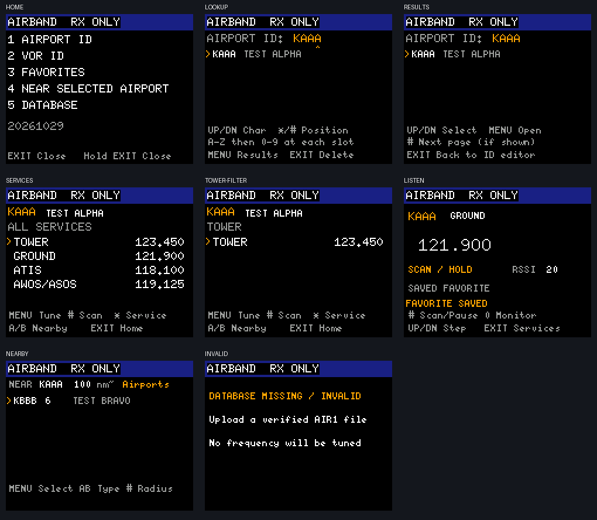

# AIRBAND

AIRBAND is an offline, receive-only US airport and VOR directory for the custom
UV-5RM firmware. It adds identifier lookup, service selection, favorites,
facility scanning and manually centered nearby lists without requiring a phone,
network connection or GPS.

This change is intentionally limited to AIRBAND. It does not include RF-chip
drivers, clock initialization, board-specific power settings, global firmware UI
styling or boot-background changes. For `5RHBK` hardware, this feature is
intended to be used after the separate BK4819 work in PR #3 is merged or applied.



The preview uses a small synthetic fixture. The distributed database contains
the FAA data described below rather than the test frequencies in the image.

## Features

- Search by FAA airport identifier, verified ICAO alias or VOR identifier.
- Select Tower, Ground, ATIS, AWOS/ASOS, CTAF, UNICOM, Clearance, Approach,
  Departure, combined Approach/Departure and other published VHF services.
- Listen in AM, filter a facility by service and scan its displayed frequencies.
- Store eight favorites in two alternating sectors with interrupted-write
  recovery.
- Browse airports or VORs near an airport explicitly selected by the user, with
  approximate distance sorting and 50, 100 or 200 nautical-mile filters.
- Display the database effective date and facility counts on the radio.

AIRBAND never enables app PTT and never calls the transmit or tone APIs. Other
firmware screens and applications retain their normal capabilities, so the
radio's TX inhibit setting remains important.

## Current release artifacts

| Component | Size | SHA-256 |
|---|---:|---|
| `apps/airband.app` | 29,884 bytes | `9a0b98c280816304db2f4a692d6911acf6ea23257463f329645a55792d56a6f1` |
| `airband/airband.db` | 305,129 bytes | `16db31f1440a1428d290d5dc6d8fb4f94af343d201aae696aac69a55c2925208` |

The feature-gated default-hardware firmware build is 61,388 bytes out of the
61,440-byte application limit. No prebuilt hardware-specific firmware image is
part of this AIRBAND change. Machine-readable build and validation details are
in [artifacts.json](artifacts.json).

## Included FAA data

The included database uses FAA NASR cycle **2026-10-29** and contains:

- 7,740 US airports with supported published VHF communications;
- 783 operational VOR-family navaids;
- 23,784 distinct service/frequency entries; and
- 293 verified identifier aliases.

The database includes canonical FAA identifiers, ICAO aliases, facility names,
coordinates and supported frequencies. Its source ZIP hashes and coverage
metadata are recorded in [airband.json](airband.json).

Source: [FAA 28-day NASR data](https://www.faa.gov/air_traffic/flight_info/aeronav/Aero_Data/NASR_Subscription/).

The database is not a live aviation-information service. It does not receive
NOTAMs, temporary frequencies, sector assignments or facility status changes.
UHF services, NDBs and unsupported frequency/channel formats are excluded
instead of being rounded. Names are abbreviated to 22 ASCII characters, and
free-form sector remarks are omitted. Use current official information when a
facility publishes multiple frequencies for the same service.

VOR/VOR-DME/VORTAC records expose only the VHF VOR frequency for listening. The
app does not decode bearing, radial, DME or TACAN.

## Opening AIRBAND

With the `airband` firmware feature enabled, press **Band / SCAN** from the main
radio screen. `AIRBAND` is the first item in that frequency/mode list. It is not
duplicated in the ordinary app launcher. Closing AIRBAND returns to the
frequency/mode list.

The AIRBAND route uses zero-based app slot 5, replacing FOX HUNT. Existing saved
channel-mode IDs keep their previous meaning.

## Controls

At the AIRBAND home screen:

| Key | Action |
|---|---|
| 1 | Search airport identifiers |
| 2 | Search VOR identifiers |
| 3 | Open favorites |
| 4 | Open Nearby around the saved airport center |
| 5 | Show database date and counts |
| Exit / hold Exit | Close AIRBAND |

### Identifier editor

The editor accepts one to four letters or digits:

- Up/Down cycles the selected position through `A`–`Z`, then `0`–`9`.
- `#` moves right and creates the next position as `A`.
- `*` moves left.
- Exit deletes the last position. At one remaining position, Exit returns home.
- Menu opens matching results.
- In results, Up/Down selects, Menu opens, Exit returns to the editor and `#`
  advances through additional pages.

The `^` marker identifies the position being edited. Search checks canonical FAA
identifiers and verified aliases. Airport and navaid identifiers occupy separate
namespaces.

### Facility frequency list

| Key | Action |
|---|---|
| Up/Down | Select a published frequency |
| Menu | Listen to the selected frequency |
| `*` | Cycle the facility's service filters, then All |
| `#` | Scan the displayed service-filtered list |
| A/B | Save this airport as the Nearby center and open Nearby |
| Exit | Return home |

### Listening

| Key | Action |
|---|---|
| Up/Down | Step within the active service filter |
| `#` | Start or pause scanning |
| `*` | Save or remove the current entry as a favorite |
| 0 | Toggle Monitor and stop scanning |
| Exit / Menu | Return to the facility list |
| Hold Exit | Close AIRBAND |

Scanning dwells for about 300 ms on a clear channel, holds while squelch is open
and resumes after about 1.5 seconds of quiet. Continuous ATIS/AWOS may hold the
scan indefinitely; Up/Down skips it. A single-frequency list stays tuned rather
than repeatedly reinitializing the receiver. Scanning uses at least squelch
level 1 even when the global setting is 0.

In Nearby, A/B switches between airports and VORs, `#` changes radius, and Menu
opens an entry. Distances are approximate distances from the selected airport,
not measured distances from the radio. Nearby does not infer location.

## Build

Run commands from `UV-5RM Custom Firmware`. Build the four-segment app package:

```sh
python3 source-changes/airband/build.py
```

Build the firmware feature against the upstream/default hardware path:

```sh
cargo build --release --locked \
  --manifest-path firmware-source/Cargo.toml \
  --config source-changes/airband/firmware.toml \
  --features airband \
  --target-dir /tmp/uv5rm-airband-fw
```

The supplied Cargo configuration enables LLVM machine outlining because the
firmware is close to its 60 KiB limit. Do not increase the linker limit to make
an oversized image fit. Each overlay segment must remain within 8 KiB, and the
packaged app must remain within its 32 KiB slot.

This PR does not provide a board-specific `.BF`. Wrap and flash the result using
the repository's established process for the target hardware. Users of hardware
covered by PR #3 should combine AIRBAND only after that board support is present;
AIRBAND itself contains no substitute RF driver changes.

## Install the app and database

The radio must already be running firmware built with the `airband` feature. A
current Python 3 and `pyserial` are required:

```sh
python3 -m pip install pyserial
python3 source-changes/airband/install.py /dev/cu.usbserial-10 \
  --backup backup/airband-first-install
```

Replace the example serial port with the actual device. The installer:

1. validates the AIR1 database and app ABI locally;
2. performs a read-only AIR1 capability query before any erase;
3. creates a new backup directory and saves the existing database/favorites and
   slot 5 contents;
4. uploads and verifies the complete database;
5. confirms favorites were unchanged;
6. installs AIRBAND into fixed slot 5; and
7. verifies the complete app readback.

The backup directory must not already exist. Use a new name on every install.
After the radio restarts, disconnect the programming cable before evaluating
internal-speaker audio.

Running the generic standard-app installer later restores FOX HUNT into slot 5.
If that happens, rerun the AIRBAND installer. The original FOX HUNT app remains
available as `apps/foxhunt.app`.

## Updating from FAA sources

FAA NASR data normally changes every 28 days. Database updates do not require a
firmware reflash when the AIR1 format remains compatible.

### 1. Choose an effective cycle

Open the FAA NASR subscription page and choose a cycle whose effective date has
arrived. Do not publish or install a preview cycle before its effective date.
Record the date as `YYYY-MM-DD`.

### 2. Download and build

The builder needs `APT.zip`, `FRQ.zip` and `NAV.zip`. It can download them into a
new source directory and construct the nationwide database in one command:

```sh
python3 source-changes/airband/database.py \
  --download \
  --source backup/faa-2026-10-29 \
  --effective 2026-10-29 \
  --output airband/airband.db
```

For files downloaded manually, place the three ZIPs in the source directory and
omit `--download`:

```sh
python3 source-changes/airband/database.py \
  --source backup/faa-2026-10-29 \
  --effective 2026-10-29 \
  --output airband/airband.db
```

To build a smaller regional database, add state abbreviations after `--states`:

```sh
python3 source-changes/airband/database.py \
  --download \
  --source backup/faa-midwest \
  --effective 2026-10-29 \
  --states IL WI IN \
  --output airband/airband.db
```

The builder checks each source ZIP's effective date, rejects malformed records,
fails when the reserved partition would overflow, and fails if a facility has
more than the app's 64-frequency limit. It never silently truncates those cases.
The nationwide database currently leaves about 63 KiB free.

After a successful build, inspect the generated metadata and record its SHA-256,
effective date, source ZIP hashes, counts and coverage. Commit `airband.json`
alongside a published database update so its provenance is reviewable.

### 3. Test the generated database

Run the complete offline test suite before touching a radio:

```sh
python3 source-changes/airband/test.py
```

The tests cross-check Python and Rust parsing against the national database,
exercise aliases and facility types, validate CRC failures, and cover lookup,
favorites, scanning, Nearby and receive-only behavior.

### 4. Upload only the database

With the radio on normally and the programming cable connected:

```sh
python3 source-changes/airband/install.py /dev/cu.usbserial-10 \
  --database-only \
  --backup backup/airband-data-2026-10-29
```

The installer backs up the old data/favorites region, uploads the new database,
validates its CRC by full readback and confirms favorites are unchanged. Favorite
records resolve by identifier, facility type, service and frequency rather than
unstable database row numbers. A favorite missing from the new cycle is refused
instead of being silently tuned to another record.

## Flash allocation and compatibility

| Address | Size | Purpose |
|---|---:|---|
| `0x194000..0x1EDFFF` | 360 KiB | AIR1 database |
| `0x1EE000..0x1EFFFF` | 8 KiB | Alternating favorites sectors |
| `0x1F0000..0x1F3FFF` | 16 KiB | Existing TEXT log, preserved |

With the `airband` feature, the legacy satellite-data write command becomes a
512-byte block-addressed AIR1 upload. Legacy satellite upload is therefore not
compatible with this profile. The default firmware profile is unchanged when
the feature is disabled. No app ABI fields were added, so existing apps remain
compatible.

## Validation and known limitations

Offline validation includes 12 Python checks, 37 native app-profile tests and
four firmware menu-route test runs. The default firmware and the feature-gated
AIRBAND firmware both build successfully. The exact clean PR firmware build has
not been flashed to hardware; hardware-specific validation belongs with the
appropriate board-support layer.

- Automatic location is not implemented. See the
  [future research proposal](../../docs/airband-location-future/README.md).
- VOR radial decoding is not implemented. It requires relative phase recovery
  from two 30 Hz navigation components, including the 9,960 Hz subcarrier path.
  The app ABI exposes RSSI and squelch, not received-baseband samples.
- RSSI is not distance, and a heard frequency is not proof of a specific station
  because aviation frequencies are reused.
- Host previews and mocked-radio tests do not prove physical AM performance.
- This tool is for listening/site discovery, not flight navigation.

## Source map

| Path | Responsibility |
|---|---|
| `firmware-source/apps/airband/src/db.rs` | AIR1 parsing, lookup and identifier editor |
| `firmware-source/apps/airband/src/logic.rs` | Home, results and facility UI |
| `firmware-source/apps/airband/receiver/` | Frequency/service selection |
| `firmware-source/apps/airband/listener/` | AM listening, RSSI, scanning and favorites |
| `firmware-source/apps/airband/nearby/` | Manually centered nearby lists |
| `firmware-source/src/app/menu_routes.rs` | Feature-gated Band/SCAN route and slot mapping |
| `source-changes/airband/database.py` | FAA NASR parser and AIR1 packer |
| `source-changes/airband/install.py` | Capability check, backup, upload and verification |
| `source-changes/airband/test.py` | Offline test orchestration |

## Reporting problems

Include the exact firmware/app/database hashes, hardware boot identifier, host
OS, key sequence, frequency, service, signal indication, squelch state and
whether disconnecting the cable changed audio. Do not post raw calibration,
configuration, channel, TEXT or backup files publicly.
