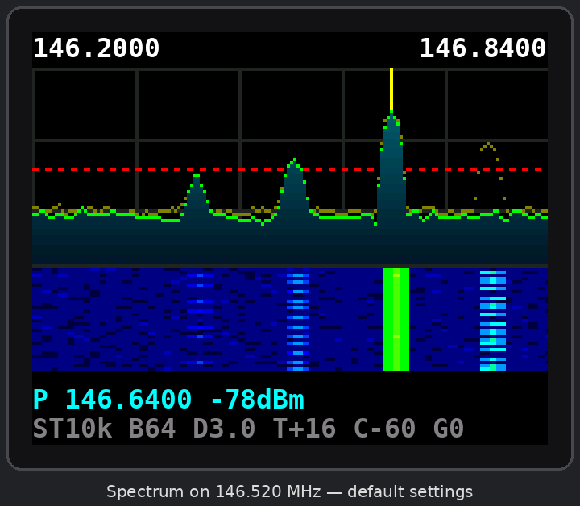
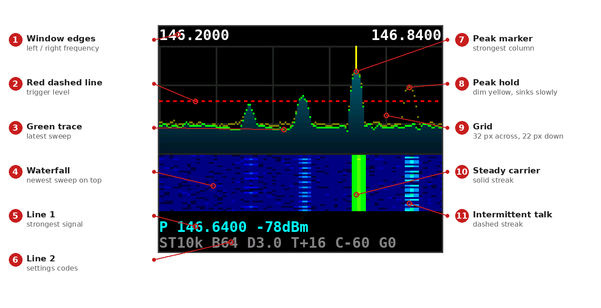
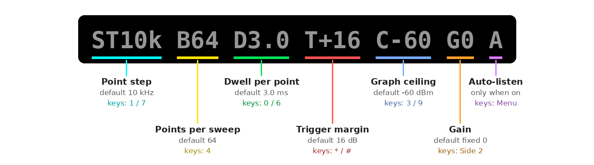
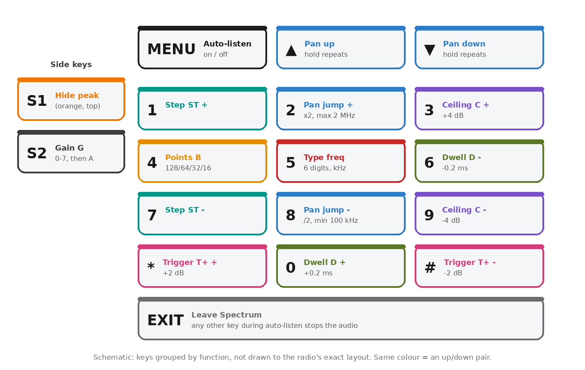
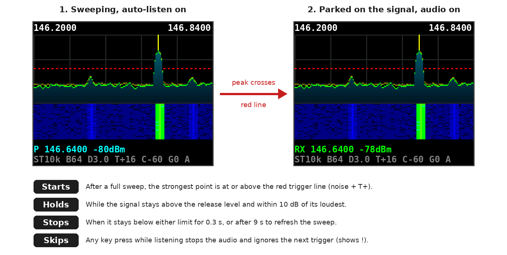
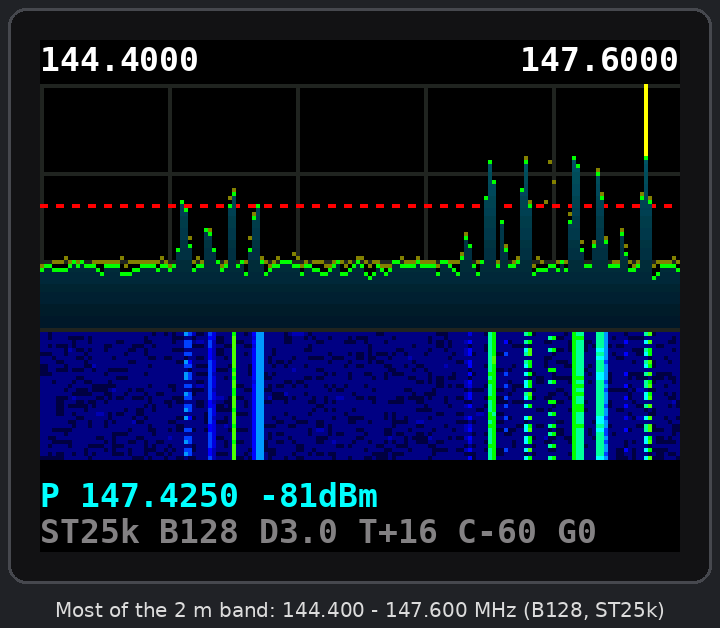
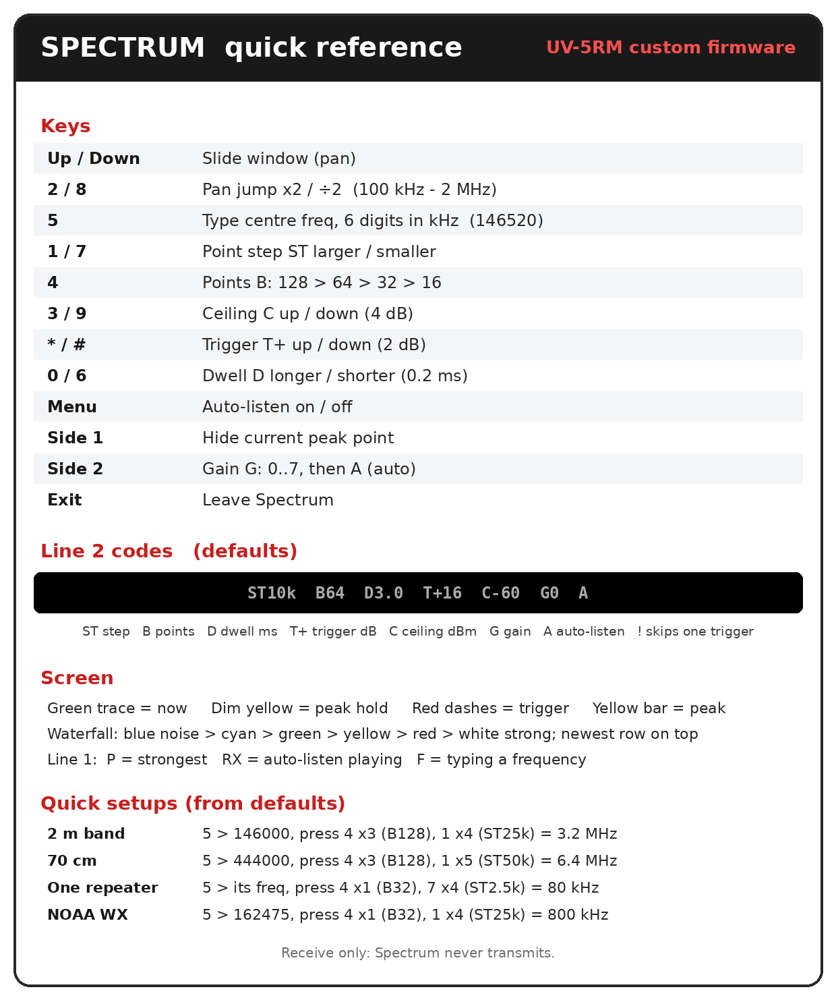

# UV-5RM Spectrum App: Complete Guide

## What Spectrum does

Spectrum turns the UV-5RM into a band scope: it sweeps the receiver across a window of frequencies, measures signal strength at each point, and draws a live graph with a scrolling waterfall underneath. You see activity on a band at a glance instead of scanning channel by channel.

- **Receive only.** The app never keys the transmitter, so it's safe to leave running.
- **Good for:** finding active repeaters and simplex calls, spotting beacons and data bursts, checking whether a frequency is clear, and seeing interference or birdies.
- **Not a replacement for your channel:** while Spectrum runs, the radio is sweeping, so you won't hear your normal channel unless auto-listen parks on a signal.

This guide matches the V2.0 firmware, on both the FD6818 build and the BK4819 (`5RHBK`) build. The screen illustrations are drawn to the radio's real 160 × 128 layout, with example signals.

## Opening the app

Spectrum opens centred on the frequency you were on, sweeping 64 points 10 kHz apart: a window 640 kHz wide.

1. On the main screen, tune to the frequency you want in the middle (frequency mode or a channel). For 2 m, 146.520 MHz is a good start.
2. Press **Menu** and pick **SPECTRUM** from the app list.
3. The graph fills from left to right as the first sweep runs, then keeps updating; the waterfall starts scrolling after the first full sweep.
4. Press **Exit** to leave. The radio goes back to normal receive with auto gain.

*Figure 1. Spectrum just after opening on 146.520 MHz: two repeaters and a simplex signal in a 640 kHz window.*

## Reading the screen

The screen has five parts, top to bottom: edge frequencies, the graph, the waterfall, and two status lines.

*Figure 2. The parts of the Spectrum screen.*

| Part | What it shows |
| --- | --- |
| **Header** | Frequency at the left edge and the right edge of the window |
| **Green trace** | Signal strength at each point of the latest sweep; higher = stronger. The shaded area under it fills from dark to bright green |
| **Dim yellow line** | Peak hold: the highest level each column reached recently. It sinks slowly, so short bursts stay visible after they end |
| **Red dashed line** | Trigger level: noise floor + the trigger margin. A signal above it counts as real activity and can start auto-listen |
| **Yellow vertical marker** | Column of the strongest signal currently held as the peak |
| **Grid** | Faint lines every 32 pixels across and about 22 pixels down, for judging position and level |
| **Waterfall** | Recent sweeps stacked, newest at the top. Colour = strength: dark blue (noise) → cyan → green → yellow → red → white (very strong). Steady carriers draw vertical streaks; intermittent talk draws dashes |
| **Line 1** | `P <freq> <dBm>`: the strongest signal (cyan text). `RX <freq> <dBm>`: auto-listen is playing that signal (green). `F ---.--- MHz`: you're typing a frequency (yellow). `PAN <n>k`: no peak yet; shows the Up/Down jump |
| **Line 2** | The current settings, in short codes (next section) |

The graph's top is set by the ceiling (`C`, default −60 dBm). Signals stronger than that clip at the top; lower the ceiling with **9** to see weak signals larger, raise it with **3** for strong local ones.

## Status line codes

Line 2 reads like `ST10k B64 D3.0 T+16 C-60 G0`: every setting you can change, in order.

*Figure 3. Line 2 decoded.*

| Code | Meaning | Default | Range | Keys |
| --- | --- | --- | --- | --- |
| `ST` | Step between sweep points | 10k (10 kHz) | 10 Hz – 100 kHz, 15 values | **1** up, **7** down |
| `B` | Number of points (bins) per sweep | 64 | 128, 64, 32, 16 | **4** cycles |
| `D` | Dwell: time spent measuring each point, in ms | 3.0 | 0.2 – 12.0 ms, 0.2 ms steps | **0** longer, **6** shorter |
| `T+` | Trigger margin above the noise floor, in dB | 16 | 2 – 40 dB, 2 dB steps | **\*** up, **#** down |
| `C` | Ceiling: the level at the top of the graph, in dBm | −60 | −120 to −20, 4 dB steps | **3** up, **9** down |
| `G` | Receiver gain: fixed level 0–7, or `A` for automatic | 0 | 0–7, A | **Side 2** cycles |
| `A` | Auto-listen is on (shown only when on) | off | on/off | **Menu** |
| `!` | Auto-listen skips the next trigger (you pressed a key while it was listening, or it broke off after 9 s); clears by itself after one sweep | — | — | — |

The window width is `ST × B`: 10 kHz × 64 = 640 kHz by default. The step values are 10 Hz, 100 Hz, 500 Hz, 1, 2.5, 5, 6.25, 8.33, 10, 12.5, 15, 20, 25, 50 and 100 kHz, and the list wraps around at each end.

## Key reference

Every key on the front panel does something in Spectrum; the number keys come in up/down pairs stacked in the same column.

*Figure 4. The keypad in Spectrum.*

| Key | Action |
| --- | --- |
| **Up / Down** | Slide the window up or down by the pan step (hold to repeat) |
| **2 / 8** | Pan step bigger / smaller: doubles or halves, 100 kHz – 2 MHz (default 800 kHz) |
| **5** | Type a centre frequency: six digits in kHz, e.g. `146520` = 146.520 MHz; it jumps after the sixth digit, or press **Menu** sooner (missing digits count as 0). **Exit** clears, then cancels |
| **1 / 7** | Point step (`ST`) larger / smaller |
| **4** | Points per sweep (`B`): 128 → 64 → 32 → 16 |
| **3 / 9** | Ceiling (`C`) up / down |
| **\* / #** | Trigger margin (`T+`) up / down |
| **0 / 6** | Dwell (`D`) longer / shorter |
| **Menu** | Auto-listen on / off |
| **Side 1** (orange, top) | Hide the current peak point from the sweep, e.g. a birdie or a noisy neighbour. It stays hidden until the window changes |
| **Side 2** (black, bottom) | Gain (`G`): 0 → 1 … 7 → A (automatic) → 0 |
| **Exit** | Leave Spectrum |

Changing step, points, gain or window restarts the sweep, so the graph and waterfall clear and refill. Changing ceiling, trigger, dwell or pan step does not.

## Auto-listen

With auto-listen on, the radio stops on the strongest signal that crosses the red trigger line and plays its audio, then goes back to sweeping when it fades: a visual scanner that only stops on real activity.

*Figure 5. How auto-listen starts and stops on a signal.*

1. Press **Menu**. `A` appears at the end of line 2.
2. After each full sweep, the app checks the strongest point. If it reached the trigger line (noise floor + `T+`), the radio tunes there and opens the speaker. Line 1 turns green: `RX 146.9400 -78dBm`.
3. While parked, it keeps reading the signal. It lets go when the level stays for 0.3 s either below the release level (noise floor + half the trigger margin) or more than 10 dB under the strongest level it heard on that frequency.
4. After 9 s on one signal it breaks off, runs one sweep to refresh the picture, then can park again. A long QSO therefore plays with a short gap every 9 seconds.
5. Pressing any key while it's listening stops the audio and skips the next trigger (line 2 shows `!`); auto-listen resumes by itself after one sweep. Press **Menu** to turn it off completely.

**How the noise floor is found:** each sweep, the app takes the median (50th percentile) of all points as the floor and the 95th percentile as the top of the noise. The trigger sits `T+` dB above the noise top, so it adapts as band noise changes. Raise `T+` with **\*** if it keeps stopping on noise; lower it with **#** to catch weaker stations.

## Recipes

Each recipe starts from the defaults the app opens with (`ST10k B64`). Key presses are counted from there.

### Watch most of the 2 m band

Shows 144.400 – 147.600 MHz in one view, which covers the repeater outputs and the simplex calling frequency.

1. Press **5**, type `146000`.
2. Press **4** three times → `B128`.
3. Press **1** four times → `ST25k`. The window is now 128 × 25 kHz = 3.2 MHz.
4. Press **Menu** if you want it to stop and play whatever comes up.

*Figure 6. The 2 m view: repeater outputs show as tall spikes and waterfall streaks.*

### Close-up on one repeater

See one repeater and its neighbours clearly, e.g. 146.940 MHz.

1. Press **5**, type `146940`.
2. Press **4** once → `B32`.
3. Press **7** four times → `ST2.5k`. The window is 80 kHz wide.
4. Press **0** a few times for a longer dwell if the trace looks jumpy.

### Scan the 70 cm repeater band

1. Press **5**, type `444000`.
2. Press **4** three times → `B128`.
3. Press **1** five times → `ST50k`. The window covers 440.800 – 447.200 MHz.

### Check NOAA weather

1. Press **5**, type `162475`.
2. Press **4** once → `B32`, then **1** four times → `ST25k`. The 800 kHz window holds all seven weather channels (162.400 – 162.550 MHz).
3. The nearest transmitter shows as a constant streak in the waterfall.

### Tame a noisy band

- One spot always high (a birdie from the radio itself, or a neighbour's device): wait until the peak marker sits on it, then press **Side 1**.
- Auto-listen keeps stopping on noise: press **\*** to raise `T+` by 2 dB at a time.
- A strong local station swamps the graph: press **3** to raise the ceiling, or **Side 2** to try another fixed gain.

## Trade-offs and troubleshooting

Every sweep costs points × dwell, so a wider or more detailed view refreshes more slowly and can miss short bursts between passes.

| Setup | Window | Sweep time (measuring only) | Best for |
| --- | --- | --- | --- |
| `B16` × 3.0 ms | narrow | about 0.05 s | Watching one frequency react instantly |
| `B64` × 3.0 ms (default) | 640 kHz at 10 kHz | about 0.2 s | General use |
| `B128` × 3.0 ms | 3.2 MHz at 25 kHz | about 0.4 s | Whole 2 m repeater band |
| `B128` × 12.0 ms | any | about 1.5 s | Very weak, steady signals |

The radio also needs time to retune between points, so real sweeps run somewhat slower than these figures.

- **Step wider than the signal:** an FM voice signal is about 12–16 kHz wide. With `ST50k` or `ST100k`, a station between two points can be missed or look weaker. Use 25 kHz or less when the gaps matter.
- **Step much narrower than the signal:** one station spreads across several points as a wide hump. That's normal and good for close-ups.
- **Short bursts vanish:** the dim yellow peak-hold line keeps them visible for a while; the waterfall also records them as short dashes.
- **Graph flat at the top:** the ceiling is too low for that signal. Press **3**.
- **Everything looks like noise:** lower the ceiling with **9**, try `G` = `A` with **Side 2**, and check the antenna is on.
- **No audio in auto-listen:** check that `A` shows on line 2, and turn the volume knob up. If `!` shows, it's waiting one sweep.
- **Typing a frequency did nothing:** it needs six digits in kHz (`146520`, not `146.52`). Press **Menu** to accept fewer.

## Quick reference card

Print this card and keep it with the radio. It holds every key on one page.

*Figure 7. Spectrum quick reference card.*
